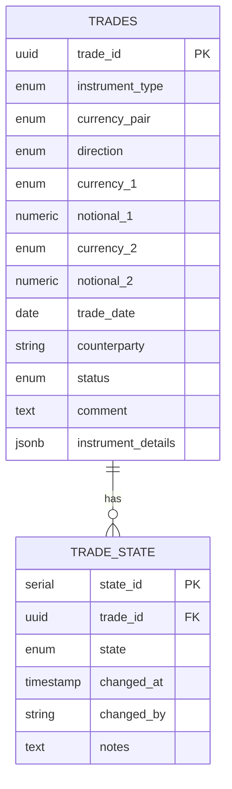

# Trade Schema Design

## Scope
Instruments in scope: FX Spot, FX Forward, FX Option.

## Common Fields (Typed Columns — `trades` table)

| Field | Type | Notes |
|---|---|---|
| trade_id | UUID | Primary key |
| instrument_type | Enum | SPOT, FORWARD, OPTION |
| currency_pair | Enum | e.g. EURUSD, GBPUSD, USDJPY |
| direction | Enum | BUY, SELL |
| currency_1 | Enum | First currency |
| notional_1 | Numeric | Amount in currency_1 |
| currency_2 | Enum | Second currency |
| notional_2 | Numeric | Amount in currency_2 |
| trade_date | Date | Date trade was booked |
| counterparty | String | Counterparty name/ID |
| status | Enum | PENDING_CONFIRMATION, BOOKED, CANCELLED, MATURED |
| comment | Text | Free-text note |
| instrument_details | JSONB | Instrument-specific attributes (see below) |

## Instrument-Specific Fields (JSONB — `instrument_details`)

### FX Spot
```json
{
  "instrument_type": "SPOT",
  "rate": 1.0850,
  "settlement_date": "2026-08-01"
}
```

### FX Forward
```json
{
  "instrument_type": "FORWARD",
  "rate": 1.0920,
  "settlement_date": "2026-11-01"
}
```

### FX Option
```json
{
  "instrument_type": "OPTION",
  "option_type": "CALL",
  "strike_rate": 1.0850,
  "premium_date": "2026-07-30",
  "expiry_date": "2026-09-15",
  "delivery_date": "2026-09-17",
  "premium": 12500,
  "premium_currency": "USD",
  "exercise_style": "EUROPEAN"
}
```

## JSONB Validation

`instrument_details` is validated at the application layer using instrument-type-specific Pydantic models (`app/schemas/instrument_details.py`) — `SpotDetails`, `ForwardDetails`, `OptionDetails` — combined into a discriminated union tagged on each model's own `instrument_type` field. Pydantic dispatches to the correct model automatically based on that tag, rejecting mismatched or incomplete instrument attributes before they reach the database. `TradeCreate` additionally cross-validates that the trade-level `instrument_type` matches the tag inside `instrument_details`, so the two can't drift apart.


## Trade Lifecycle (Append-Only — `trade_state` table)

| Field | Type | Notes |
|---|---|---|
| state_id | Serial | Primary key |
| trade_id | UUID | Foreign key to trades.trade_id |
| state | Enum | PENDING_CONFIRMATION, BOOKED, AMENDED, CANCELLED, MATURED |
| changed_at | Timestamp | When the state change occurred |
| changed_by | String | User or system that made the change |
| notes | Text | Optional context on the change |

## Design Rationale

- Common fields are stored as typed columns for query performance, referential integrity, and constraint enforcement (e.g. Enum validation at the database level).
- Instrument-specific fields are stored in a JSONB column to avoid a rigid schema that would otherwise require sparse, nullable columns for attributes that only apply to a subset of instruments (e.g. strike_rate only applies to Options).
- Trade lifecycle is modelled as a separate append-only log rather than a single mutable `status` field, preserving full audit history of every state transition.
- Owning both currency_pair and separate currency_1/currency_2 leads to some redundancy (e.g. currency_pair = EURUSD while currency_1 = EUR, currency_2 = USD separately), but this is meant to be a convenient display/lookup field and matches how real systems store the information.
- For a single-currency-pair trade, one of notional_1/notional_2 is typically derivable from the other notional + the rate (e.g. notional_1 × rate = notional_2). Storing both avoids recalculation and matches how real systems often store both fields explicitly, despite the redundancy.

## Entity-Relationship Diagram


